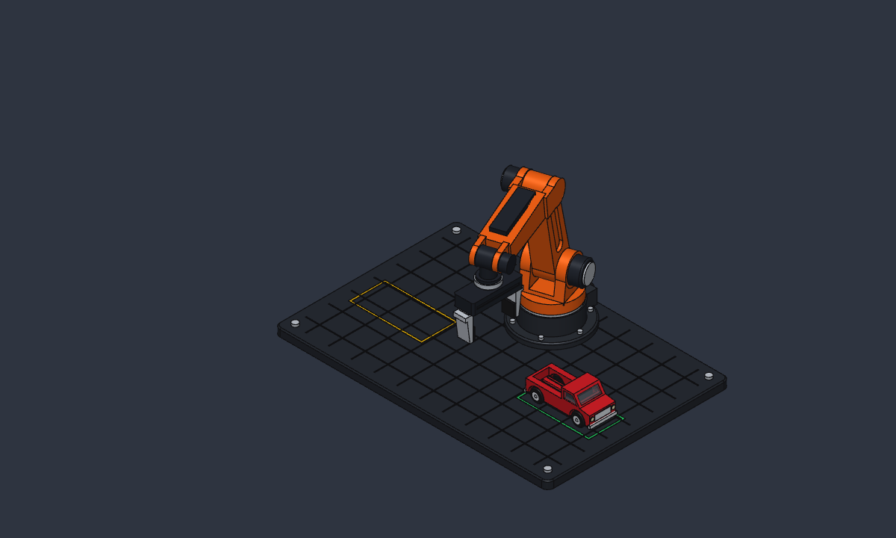
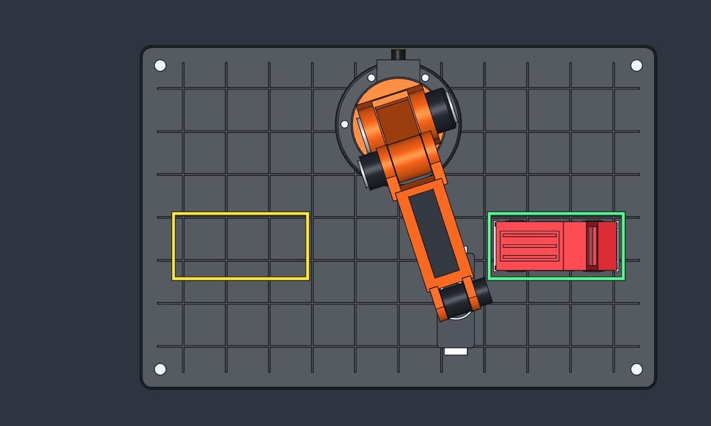

# Realistic 6-DOF Robotic Arm Grasper & Matchbox Truck Workcell

A 1:1 scale parametric/kinematic 3D CAD assembly built in **SolidCraft**, featuring a sculpted 6-axis industrial robotic arm with a parallel-jaw gripper on a machined fixture grid plate transferring a die-cast Matchbox pickup truck from **Pick Zone A** to **Place Zone B**.

## Views

| Isometric Workcell View | Top Alignment View |
| --- | --- |
|  |  |

## Assembly Overview

- **Machined Workcell Grid (`Grid`, 360 × 240 × 10 mm)**
  - Anodized charcoal fixture baseplate with 8 mm corner fillets, 1.5 mm perimeter chamfer, 30 mm X/Y grid grooves, 4 stainless hold-down bolts, **Pick Zone A** (`-110, -20`, amber), and **Place Zone B** (`+110, -20`, emerald).
- **6-DOF Industrial Robot Arm & Parallel Gripper**
  - Cast pedestal with mounting flange, 6 stainless socket bolts, rear electrical junction box + cable gland, and brushed steel slew bearing ring.
  - Twin-cheek shoulder/elbow/wrist clevises, anodized harmonic-drive servo cans with stainless end-caps, CNC-pocketed tapered upper arm (`L1 = 105 mm`), and tapered forearm (`L2 = 105 mm`) with top actuator conduit.
  - Brushed stainless ISO wrist flange, anodized gunmetal parallel gripper housing with polished carbon-steel linear guide rail, tapered bead-blast aluminum L-jaws, and matte black TPU grip pads.
- **Die-Cast Matchbox Pickup Truck (`Truck`, 84 × 38 × 35 mm)**
  - Glossy metallic crimson body with sloped hood and windshield, transparent smoked-glass cabin insert and interior bench seat, hollowed ribbed cargo bed, wheel arches, undercarriage + side steps, chrome bumpers & grille, headlights/taillights, steel axles, filleted rubber tires, and chrome rims.

## Joint Controls

All six axes are driveable in SolidCraft's **Joints** panel:

| Joint | Type | Range | Description |
| --- | --- | --- | --- |
| `Turret` | Revolute (`+Z`) | `-180° … +180°` | Waist / base slew rotation |
| `Shoulder` | Revolute (`+X`) | `-45° … +110°` | Upper arm pitch (`0°` = vertical upright) |
| `Elbow` | Revolute (`+X`) | `-90° … +90°` | Forearm pitch (`0°` = horizontal 90° L-pose) |
| `Wrist Pitch` | Revolute (`+X`) | `-110° … +110°` | Tool pitch (`-(Shoulder + Elbow)` keeps gripper vertical) |
| `Wrist Roll` | Revolute (`+Z`) | `-180° … +180°` | Tool flange rotation (`-Turret` preserves truck heading) |
| `Grip` | Slider (`±Y`) | `0 … 10 mm` | Parallel jaw stroke (`1:1` motion-linked to `Grip Follow`) |

## Pick-and-Place Trajectory (`Truck Transfer`)

The 60-step motion study executes a collision-verified (`motion.interference` `clear: true`) cosine-eased trajectory:
1. **Steps `0 → 12`**: Pure vertical liftoff (`+45 mm`) from Pick Zone A (`-110, -20`) with zero tire scrub.
2. **Steps `12 → 48`**: Smooth S-curve slew across the workcell (`+55 mm` mid-flight apex) while `Wrist Roll` counter-rotates to maintain truck alignment.
3. **Steps `48 → 60`**: Pure vertical soft touchdown into Place Zone B (`+110, -20`) until all four tires rest on `z = 0`.

## Repository Files

- `arm_grasper_truck.sc` — SolidCraft container design file
- `arm_grasper_truck.json` — Plain-JSON SolidCraft design file for readable Git diffs
- `arm_grasper_truck.step` — STEP 3D CAD assembly export
- `truck_transfer_realistic.gif` — 61-frame GPU-rendered transfer animation
- `preview_iso.png` / `preview_top.png` — High-resolution PBR viewport renders
