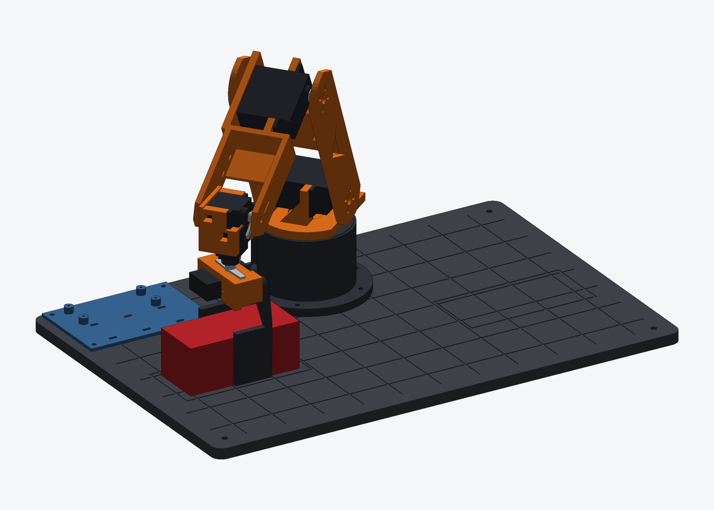
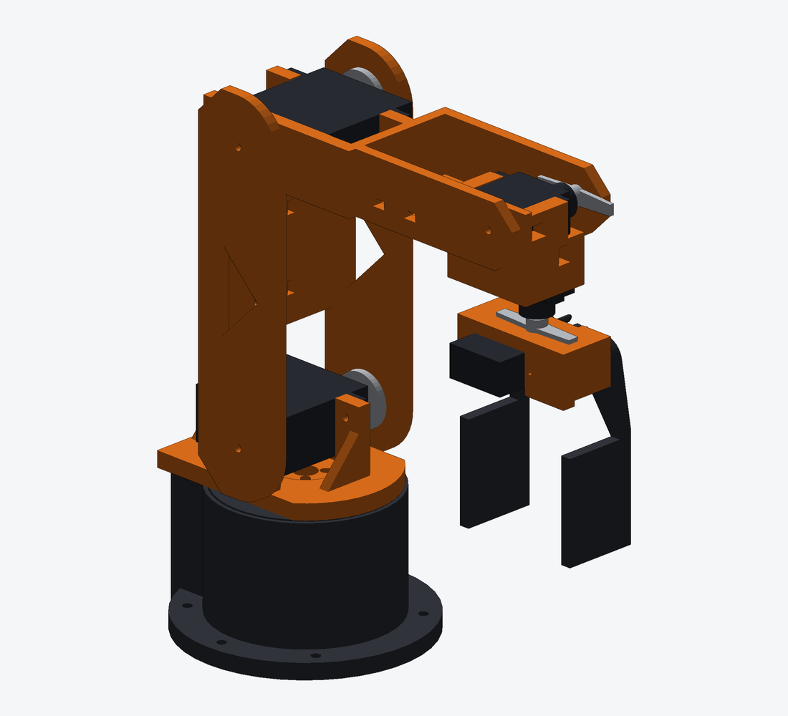
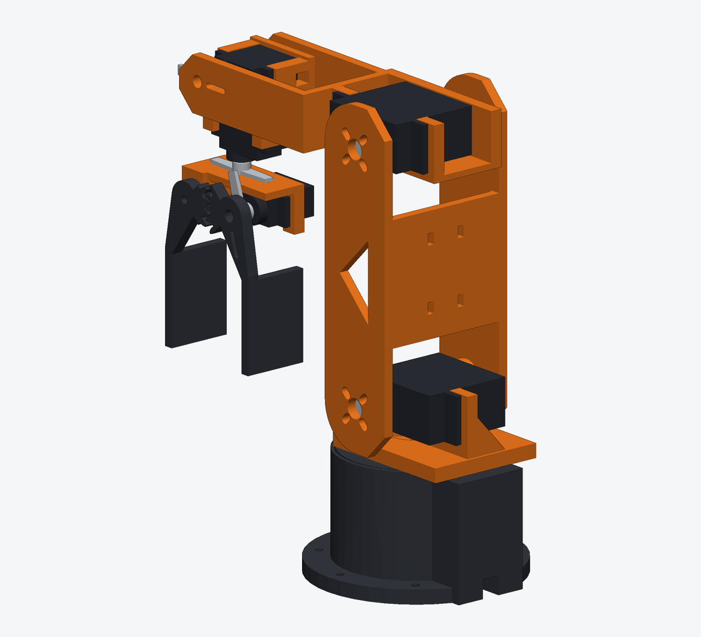
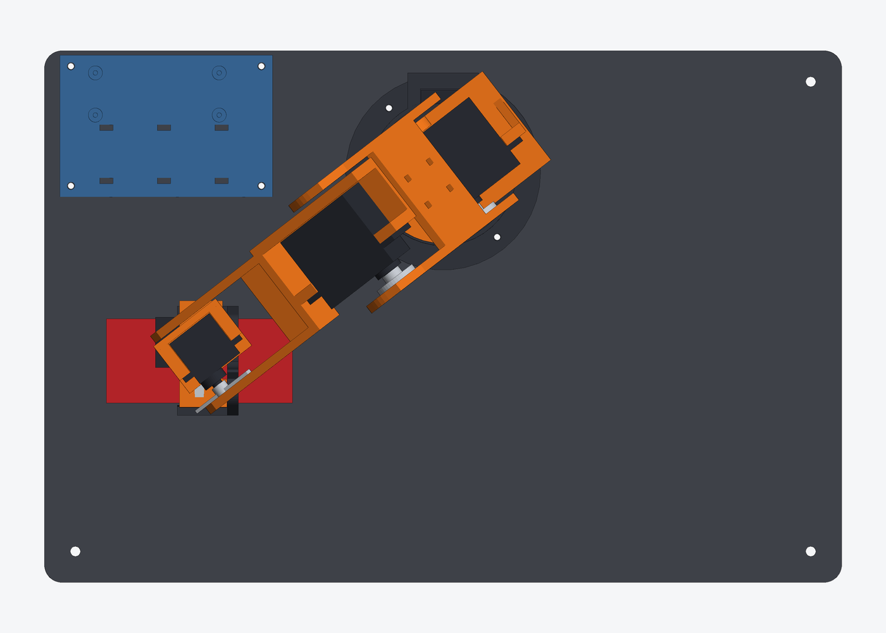
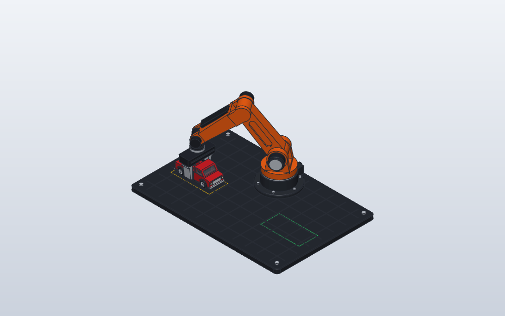

# 3D-Printable 6-Servo Robot Arm & Matchbox Truck Workcell

A desktop robot arm you can print and build: five rotary joints plus a gripper,
driven by six hobby servos, moving a Matchbox truck from **Pick Zone A** to
**Place Zone B** on a tiled grid plate.



| Front | Rear | Top |
| --- | --- | --- |
|  |  |  |

## Build it

1. **Order** the parts in [docs/BOM.md](docs/BOM.md): 3 × DS3218MG servos,
   3 × MG90S servos, 3 disc horns, a PCA9685 driver, an ESP32, a 5 V 10 A supply
   and a handful of M3/M2 screws.
2. **Print** the STL files in [`print/`](print) — no supports, fits a 180 mm bed.
   Start with `fit_test_coupon.stl`.
3. **Assemble and calibrate** following [docs/ASSEMBLY.md](docs/ASSEMBLY.md) and
   [docs/WIRING.md](docs/WIRING.md).
4. **Flash** [`firmware/arm_controller`](firmware/arm_controller) and type `run`.

## How the parts are known to fit

The printed parts are generated by a parametric CadQuery model
([`cad/`](cad)) in which every servo pocket, screw pattern and joint spacing is
derived from one table of component dimensions
([`cad/armcad/specs.py`](cad/armcad/specs.py)). The build refuses to export
unless all of the following pass ([docs/VERIFICATION.md](docs/VERIFICATION.md)):

- every servo seats on its mounting face and every horn meets the part it drives;
- no two bodies (printed parts, servos, horns, the truck) overlap anywhere along
  the pick-and-place path or at any joint limit;
- gravity torque at full stretch with a 60 g payload stays at least 2× below
  each servo's stall torque;
- every part fits a 180 × 180 mm bed and exports as a watertight mesh.

What this cannot check is your actual hardware: clone servos and horns vary by a
few tenths of a millimetre, which is why there is a fit-test coupon, slotted
horn holes and shim washers at each joint. The design has been verified in CAD
and the firmware logic on a PC; it has not yet been built physically.

## What changed from the concept model

The original SolidCraft model (`arm_grasper_truck.*`, still in this repository)
was a visual concept: solid bodies with decorative motor cans and no space for
real actuators. The arm was redesigned around the ordered parts.

| | Concept | Printable design |
| --- | --- | --- |
| Actuators | Decorative | 3 × DS3218MG + 3 × MG90S |
| Link lengths | 105 / 105 mm | 105 / 105 mm (unchanged) |
| Base position, zones, grid size | (0, 65), (∓110, −20), 360 × 240 mm | Unchanged |
| Shoulder height | 68 mm | 71.5 mm |
| Wrist axis to grip pads | 70 mm | 102 mm (two servos stacked in the wrist) |
| Arm width | 24 mm | 61.5 mm (a servo sits between the side plates) |
| Gripper | Sliding parallel jaws, 10 mm stroke | Two geared pivoting fingers, 26–58 mm opening |
| Turret range | ±180° | ±135° (servo travel) |
| Grid plate | One 360 × 240 × 10 mm plate | Six 120 mm tiles, 8 mm thick, keyed together |
| Electronics | Decorative junction box | Tray for PCA9685 + ESP32 on the grid |

The SolidCraft files were not regenerated; the CadQuery model in `cad/` is now
the source of truth. `cad/arm_assembly.step` opens in any CAD package.

## Repository layout

| Path | Contents |
| --- | --- |
| `print/` | STL files, ready to slice |
| `docs/` | BOM, wiring, assembly guide, verification report, images |
| `cad/armcad/` | Parametric model: component specs, parts, assembly, checks |
| `cad/build.py` | Verifies the design, then regenerates `print/`, the STEP file and the images |
| `cad/arm_assembly.step` | Full assembly including servos and horns |
| `firmware/arm_controller/` | Arduino sketch (ESP32 or Uno + PCA9685) |
| `firmware/test/` | PC-side tests of the kinematics and motion code |
| `arm_grasper_truck.*`, `preview_*.png`, `truck_transfer_realistic.gif` | Original concept model and renders |

## Regenerating

```bash
pip install -r cad/requirements.txt
```

```bash
python cad/build.py
```

```bash
pytest cad/tests
```

```bash
make -C firmware/test
```

## Original concept


