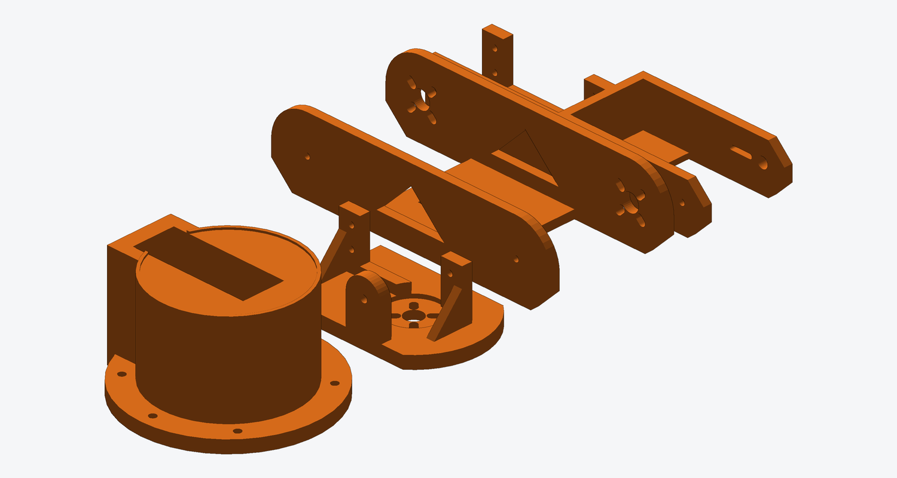
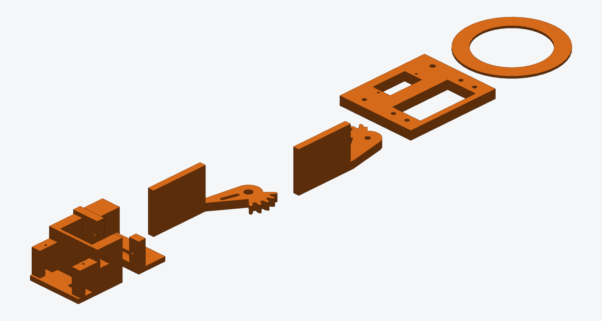
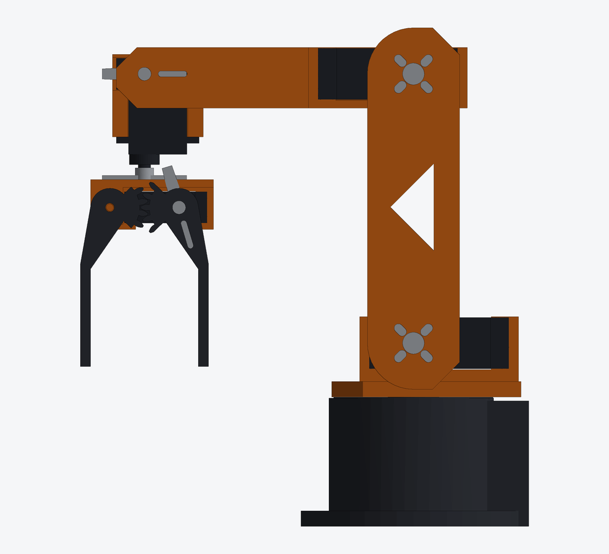
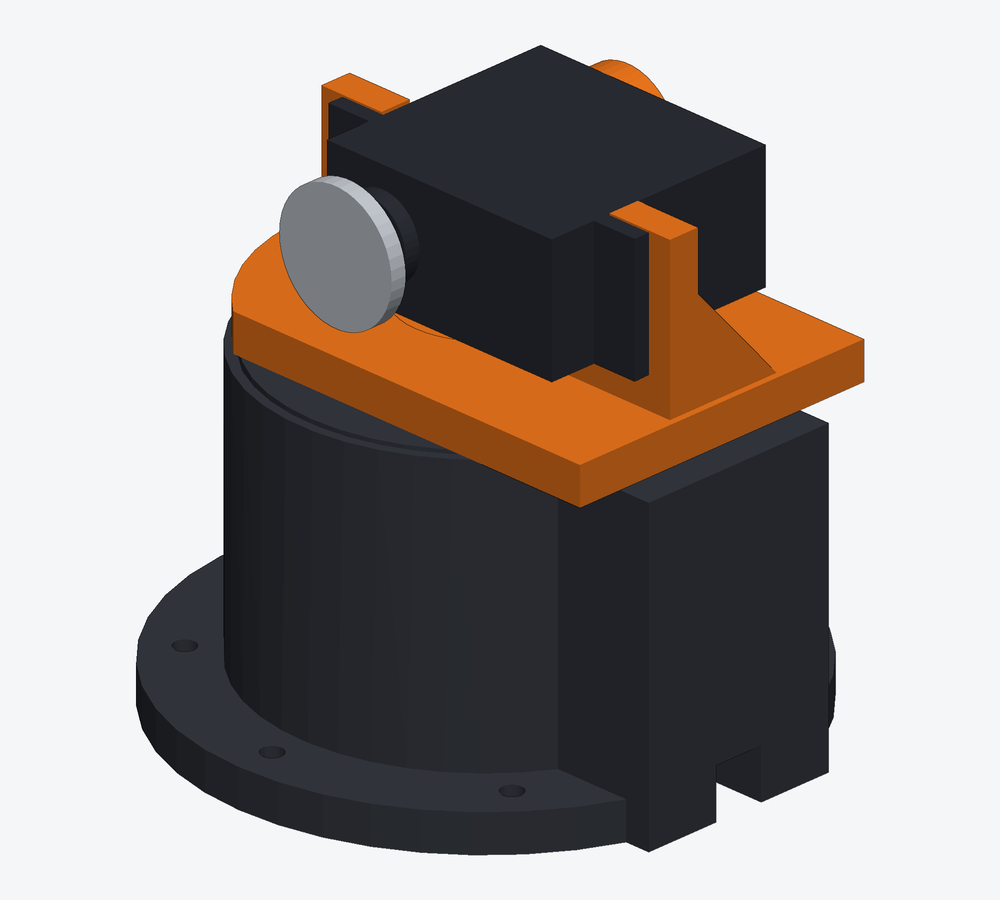
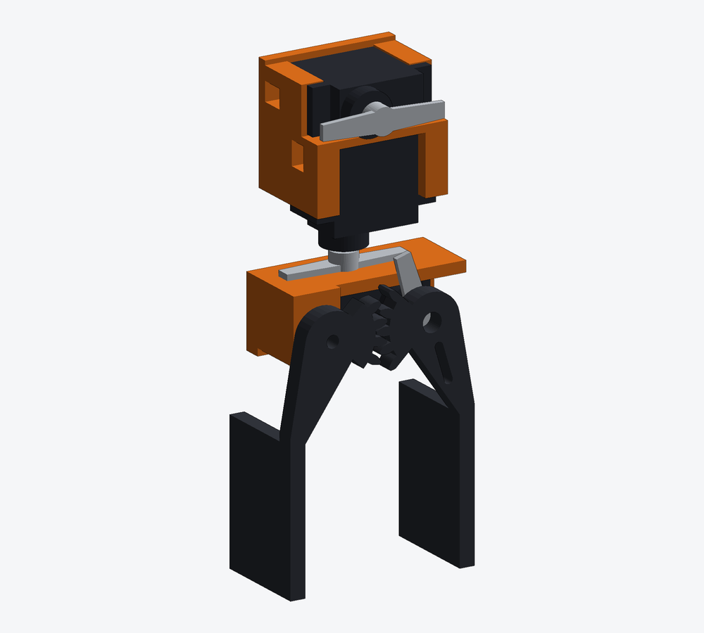

# Printing and assembly

## 1. Print

All STL files are in [`print/`](../print), already turned to their print
orientation. **No part needs supports.** Largest part: 141 × 62 mm (fits a
180 × 180 mm bed).

| Setting | Arm parts | Grid tiles, tray, base |
| --- | --- | --- |
| Material | PLA or PETG | PLA or PETG |
| Nozzle / layer | 0.4 mm / 0.2 mm | 0.4 mm / 0.2–0.28 mm |
| Walls | 4 | 3 |
| Infill | 35–40 % | 15 % |
| Top/bottom layers | 5 | 4 |

| File | Qty | Notes |
| --- | --- | --- |
| `fit_test_coupon.stl` | 1 | **Print this first** (see below) |
| `base.stl` | 1 | Upright |
| `turret.stl` | 1 | Disc on the bed |
| `upper_arm.stl` | 1 | On its back, side plates standing |
| `forearm.stl` | 1 | Floor on the bed |
| `wrist.stl` | 1 | Solid side wall on the bed |
| `gripper_body.stl` | 1 | Upside down |
| `finger_drive.stl`, `finger_idler.stl` | 1 each | Gear face on the bed; a brim helps |
| `turret_shim_*.stl` | 1 each (4) | Print the whole set |
| `grid_tile_c*_r*.stl` | 6 | `c` = column from the left, `r` = row from the front |
| `grid_key_x14.stl` | 14 | Bow-tie keys that join the tiles |
| `electronics_tray.stl` | 1 | |

### Fit test

The coupon has one window for each servo size and one of each screw hole.
Before printing anything else check that:

- a DS3218MG drops into the large window and an MG90S into the small one, with
  slight play and without force;
- an M3 screw threads firmly into the small round hole and slides freely
  through the larger one;
- the servo mounting screws bite in the pilot holes.

If a servo is tight, increase `pocket` in `cad/armcad/specs.py` (or your
slicer's horizontal hole compensation) and rebuild. If your servos measure
differently from the dimensions in `specs.py`, edit them there: every pocket and
joint spacing follows.

## 2. Centre the servos before fitting any horn

1. Wire the electronics as in [WIRING.md](WIRING.md) with all six servos
   plugged in but **not yet installed**.
2. Flash `firmware/arm_controller` (Arduino IDE, install the "Adafruit PWM Servo
   Driver Library"). On power-up every servo moves to its centre (1500 µs).
3. Leave them there. All horns are fitted with the arm in the **zero pose**:
   upper arm vertical, forearm horizontal, gripper pointing down, fingers parallel.

## 3. Grid and base

Directions below are as seen from the front: standing at the work area, facing
the arm. Zone A is on the left, zone B on the right, and all three disc horns
end up on the right-hand side of the arm.

1. Lay the six tiles face down in their positions (mirrored left-to-right while
   they are upside down) and press the 14 keys into the
   bow-tie pockets across the seams (a drop of glue makes it permanent).
   Row `r1` is the rear row; the base holes are in `c1_r1`.
2. Feed the turret servo lead down the base pocket and out through the tunnel
   at the back, then drop the servo into the base with its **output shaft
   towards the front** (the round side). Fix with 4 × M3 × 12 and washers.
3. Screw the base to the grid with 6 × M3 × 12. The square box on the base
   points to the rear.

## 4. Turret

1. Push a disc horn onto the turret servo (no centre screw yet).
2. Place the 1.4 mm shim ring on top of the base, inside the raised rim.
3. Set the turret on the horn with its long tongue pointing to the rear.
   Fix it to the horn with 4 × M3 × 8 through the slotted holes, then fit the
   horn's centre screw through the middle hole.
4. Turn the turret by hand. It should rotate freely with almost no rocking:
   swap in a thicker shim if it rocks, a thinner one if it drags. Grease the shim.
5. Slide the shoulder servo into the turret from the side of the tall wall,
   output shaft at the front, and fix with 4 × M3 × 12. Push on a disc horn.

## 5. Upper arm and forearm

1. Fit the elbow servo into the forearm the same way (4 × M3 × 12): output
   shaft at the open end of the forearm (the end away from the wrist fork), on
   the same side as the shoulder horn. Push on the third disc horn.
2. Lower the upper arm over the turret, vertical, with the plate that has the
   four-slot hole patterns on the horn side. Bolt it to the horn (4 × M3 × 8),
   then fit the horn centre screw through the large hole.
3. On the other side, thread an M3 × 10 with a washer through the plate so its
   tip runs in the hole of the turret's pivot wall, slipping M3 washers onto it
   inside the gap until the gap is filled (nominally 3 washers).
4. Slide the forearm between the plates at the top, pointing forward and
   horizontal. Bolt the horn, fit the centre screw, and fit the pivot screw
   with shim washers exactly as for the shoulder.

## 6. Wrist and gripper

1. Screw the wrist-pitch servo into the upper level of the wrist block and the
   roll servo, shaft down, into the lower level (2 tab screws each). Their leads
   leave through the notches.
2. Push a double-arm plastic horn onto the pitch servo, pointing towards the
   elbow. Slide the wrist block between the forearm prongs, roll servo pointing
   down. Drive 2 × M2 × 8 through the prong slot into two holes of the horn,
   fit the horn centre screw through the round hole, and on the other prong
   thread an M3 × 8 with a washer into the wrist block as the pivot.
3. Push a horn onto the roll servo, in line with the forearm. Hold the gripper
   body under it with its slot pointing towards the elbow (the finger side is
   then on the same side as the disc horns) and drive 2 × M2 × 6 up through the
   slot into the horn; fit the centre screw.
4. Slide the gripper servo up into the gripper body, output shaft on the finger
   side at the end nearest the elbow, and fix it with 2 tab screws.
5. Push a horn onto the gripper servo pointing down and slightly outwards, lay
   the drive finger on it and fix with 2 × M2 × 8 through the slot plus the
   centre screw.
6. Mesh the idler finger so both fingers hang parallel and fix it with the
   M3 × 16 and a washer — snug, but free to turn. Grease the teeth.
7. Stick a 2 mm rubber pad on the inside of each jaw.

## 7. Calibrate

Open the serial monitor at 115200 baud.

1. `home` — the arm goes to the zero pose. Horn splines only index in steps of
   14–17°, so trim each joint until the pose is exact, e.g. `trim 1 20` shifts the
   shoulder by +20 µs. `show` prints the resulting values; copy them into
   `centerUs` in `ArmConfig.cpp` and re-flash.
2. Check directions with small moves: `j 1 10` must lean the upper arm forward,
   `j 2 10` must lower the forearm tip, `j 0 10` must turn the arm towards zone B
   (the right side), `grip 50` must open the jaws. If a joint moves the wrong
   way, flip the sign of its `usPerDegree` in `ArmConfig.cpp`.
3. `go 0 -74 60` moves the jaws over the middle of the grid; `go -110 -20 14`
   puts them around a truck standing in zone A.
4. `run` performs the full pick-and-place from zone A to zone B.

## Joint ranges

| Joint | Range | Servo |
| --- | --- | --- |
| Turret | −135° … +135° | DS3218MG |
| Shoulder | −30° … +90° (0° = upright, + = forward) | DS3218MG |
| Elbow | −90° … +45° (0° = forearm square to upper arm, + = tip down) | DS3218MG |
| Wrist pitch | −90° … +30° | MG90S |
| Wrist roll | −90° … +90° | MG90S |
| Gripper | 26 … 58 mm between the pads | MG90S |

The firmware enforces these limits; they are the ranges the CAD interference
check covers.
